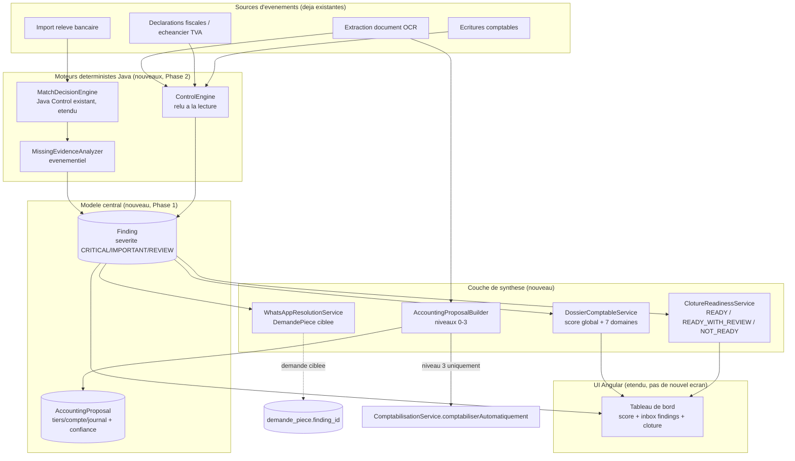

# Rapport final — Mission P0 « Construire le Core Intelligent de Production Comptable »

Rapport obligatoire (mission, section 38, points A–L). Rédigé après exécution complète des
8 phases, vérifiées à chaque étape par une compilation, une suite de tests et — pour la
première fois de tout ce projet multi-session — une exécution réelle contre PostgreSQL réel
(Docker Compose) et un build Angular réel (JDK 26 / Maven / Node enfin disponibles dans cet
environnement).

---

## A. Audit initial

Un audit complet en 4 explorations parallèles (modules métier core, module `agent/*`,
`ai-service` Python, 22 migrations Flyway existantes) a précédé tout code. Faits qui ont
déterminé l'architecture :

- **Aucune table générique « finding/work item » n'existait.** Les deux précédents de
  pattern polymorphe en base : `ai_match_proposal` (V22) et `audit_log` (lecture seule, sans
  sévérité). `notification` n'était pas réutilisable (pas d'`entreprise_id`, pas de lien
  polymorphe).
- Les sections 7 et 18 de la mission décrivaient le **même concept deux fois** (`WorkItem`
  puis `Finding`) — un seul modèle a été construit.
- `ComptabilisationService.comptabiliserAutomatiquement` **échouait systématiquement** —
  un stub jamais implémenté, pas un bug caché. Vrai point d'ancrage pour
  `AccountingProposal`.
- `LettrageService.lettrerAutomatiquement` ignorait silencieusement les groupes ambigus.
- `DeclarationFiscaleService` ne détectait jamais une période **sans aucune** déclaration
  (seul le retard sur une déclaration existante était calculé).
- Le Universal Matching Engine ne vérifiait jamais réellement la somme d'un groupe
  `ONE_TO_MANY`/`MANY_TO_ONE` — l'IA pouvait auto-déclarer un groupe cohérent sans
  vérification Java (faille corrigée en Phase 2, voir section I).
- `agent/pipeline` (LangGraph4j) ne démarrait que pour WhatsApp ; l'upload web ne passait
  jamais par le graphe.
- `demande_piece` n'avait aucun lien retour vers ce qui l'avait déclenchée.
- Le dashboard existant exposait 6 compteurs bruts, aucun score, aucune pondération.
- Deux représentations distinctes de « facture fournisseur » coexistent (`Document`
  `FACTURE_ACHAT` vs `facture_fournisseur`) — incohérence réelle, documentée, **hors
  scope P0** (recommandation P1, voir section K).

---

## B. Architecture P0 finale

Loi d'architecture appliquée partout : **l'IA propose. Java vérifie. Java décide. PostgreSQL
persiste.** Aucun nouveau moteur IA côté Python n'a été nécessaire pour ce chantier — le
Missing Evidence Engine et le Control Engine sont de l'interprétation Java pure de signaux
déjà produits par les moteurs existants (Universal Matching Engine, analyse de fraude,
échéancier TVA).



**Deux tables nouvelles seulement** (`finding`, `accounting_proposal`), toutes deux
répliquant le pattern déjà prouvé par `ai_match_proposal` — jamais un nouveau pattern
inventé. `DossierComptable` reste un DTO calculé à la lecture, jamais persisté (le score
doit rester déterministe et toujours à jour ; à l'échelle visée — 10 à 500 clients, calcul
à l'ouverture d'un dossier — la matérialisation n'apporte aucun gain réel et introduirait un
problème d'invalidation).

---

## C. Modèles créés

| Modèle | Table | Rôle |
|---|---|---|
| `Finding` | `finding` (V23) | Modèle central unique d'exception/anomalie, polymorphe (`sourceType`+`sourceId`), sévérité `CRITICAL`/`IMPORTANT`/`REVIEW`, preuve JSON, action recommandée |
| `AccountingProposal` | `accounting_proposal` (V24) | Proposition Document → Écriture (journal/tiers/compte/montants/TVA + confiance + raisons) |
| — | `demande_piece.finding_id` (V25) | Lien retour minimal (pas de nouvelle table de jonction) entre une demande client et le finding qui l'a déclenchée |

Enums nouveaux : `TypeFinding` (8 valeurs), `SeveriteFinding` (3, alphabétiquement
ordonnées pour trier 🔴🟠🟡 via un simple `ORDER BY`), `StatutFinding`,
`StatutAccountingProposal`.

Abstractions explicitement **rejetées** : une table `WorkItem` séparée (redondante avec
`Finding`), la persistance de `DossierComptable` (voir section B).

---

## D. Fonctionnalités livrées par domaine

| Domaine | Livré |
|---|---|
| **Dossier Comptable Intelligent** | Score global + 7 scores par domaine, statut `PRET`/`A_SURVEILLER`/`BLOQUE`, actions prioritaires triées par sévérité — `DossierComptableService`, `GET /api/entreprises/{id}/dossier` |
| **Work Queue / Exception Inbox** | Intégrée au tableau de bord existant (pas d'écran séparé) : liste des findings ouverts, Résoudre/Rejeter/Voir détails avec preuve JSON dépliable |
| **Universal Matching Engine V2** | Étendu (pas reconstruit) : validation de **tous** les candidats d'un groupe `ONE_TO_MANY`/`MANY_TO_ONE` (faille corrigée), vérification de somme de groupe (`verifierCoherenceMontantGroupe`) |
| **Missing Evidence Engine** | `MissingEvidenceAnalyzer`, branché après chaque décision de rapprochement, crée/résout des `Finding MISSING_EVIDENCE`/`MATCH_AMBIGUOUS` |
| **Boucle de résolution WhatsApp** | `WhatsAppResolutionService` : demande ciblée automatique (libellé avec montant/date réels) uniquement quand aucun candidat n'a été examiné — jamais pour les cas ambigus |
| **Document → AccountingProposal** | `AccountingProposalBuilder` : résolution tiers (normalisation) + compte (fréquence historique), sans appel IA supplémentaire |
| **Comptabilisation Autopilot** | Niveaux 0–3 : seul le niveau 3 (confiance ≥ 0.9, ≥ 3 occurrences cohérentes) déclenche une comptabilisation réelle via `EcritureNode`/`ComptabilisationService.comptabiliserAutomatiquement` (débloqué — était un stub qui échouait toujours) |
| **Accounting Control Engine** | `ControlEngine` : déclarations TVA manquantes/en retard, documents à risque de fraude non résolus, écritures brouillon oubliées (>30j) — jamais qualifié de « fraude » par défaut |
| **Closing Engine P0** | `ClotureReadinessService` : avis `READY`/`READY_WITH_REVIEW`/`NOT_READY`, **ne déclenche jamais** la clôture elle-même |
| **AI Copilot structuré** | **Non livré** (voir section K) |

---

## E. Répartition Java / Python par capacité

| Capacité | Java | Python (`ai-service`) |
|---|---|---|
| Décision de rapprochement (MATCH_AUTO/REVIEW/NO_MATCH) | ✅ `MatchDecisionEngine` revalide tout | Propose un score/candidat (déjà existant) |
| Détection finding manque de preuve / contrôle | ✅ 100 % Java (`MissingEvidenceAnalyzer`, `ControlEngine`) | Aucun — signaux déjà calculés |
| Résolution tiers/compte pour comptabilisation | ✅ 100 % Java (normalisation + fréquence historique) | Aucun appel IA supplémentaire |
| Score du Dossier Comptable | ✅ 100 % Java, déterministe | Aucun (exigence explicite : pas de LLM dans le score) |
| Extraction OCR, analyse de fraude visuelle, matching sémantique | Orchestration + garde-fous | ✅ Appels LLM (déjà existants, inchangés) |

Aucune nouvelle capacité Python n'a été nécessaire pour ce chantier — confirmation directe
de l'audit initial (« l'IA propose déjà tout ce qui est nécessaire, il manquait la couche
d'interprétation Java »).

---

## F. Endpoints API livrés

```
GET    /api/entreprises/{id}/dossier
GET    /api/entreprises/{id}/findings
POST   /api/entreprises/{id}/findings/{findingId}/resoudre
POST   /api/entreprises/{id}/findings/{findingId}/rejeter
GET    /api/entreprises/{id}/comptabilisation/documents/{docId}/proposition
POST   /api/entreprises/{id}/comptabilisation/propositions/{id}/accepter
POST   /api/entreprises/{id}/comptabilisation/propositions/{id}/rejeter
GET    /api/entreprises/{id}/cloture-readiness
```

Toutes protégées par `hasAnyRole("COLLABORATEUR", "EXPERT_COMPTABLE")` et l'isolation
multi-tenant existante (`EntrepriseAccessService`).

---

## G. Migrations DB

| Version | Contenu |
|---|---|
| V23 | `finding` — table centrale, index sur `entreprise_id`, `(source_type,source_id)`, `status`, `severity` |
| V24 | `accounting_proposal` — proposition de comptabilisation |
| V25 | `demande_piece.finding_id` — lien retour (colonne, pas de table) |

Aucune migration destructive. Schéma validé à `v25` sur Postgres réel à chaque run de test
(`Successfully validated 25 migrations`).

---

## H. Écrans UI modifiés

Un seul écran étendu — **le tableau de bord existant** (`tableau-de-bord.component.*`) —
conformément à la consigne « ne pas construire plusieurs interfaces redondantes » (mission
section 26) : trois nouvelles sections ajoutées au-dessus des compteurs/échéances déjà
présents :

- `.carte-dossier` : nom entreprise, statut, score global, grille des 7 scores par domaine.
- `.carte-cloture` : bloquants et avertissements de clôture.
- `.carte-findings` : inbox des actions prioritaires, badges de sévérité, actions
  Résoudre/Rejeter/Voir détails, preuve JSON dépliable.

Build Angular réel (`npx ng build --configuration=production`) vérifié après chaque
changement — vérification stricte AOT du typage des templates incluse.

---

## I. Tests — résultats réels

Pour la première fois de tout ce projet multi-session, un JDK (26), Maven et Docker
Postgres étaient réellement disponibles dans cet environnement — chaque phase a donc été
vérifiée par une exécution réelle, pas seulement une relecture manuelle.

**Résultat final agrégé (`mvn -o test`, tous modules) :**

```
Tests run: 230, Failures: 0, Errors: 1, Skipped: 0
```

Le seul échec est `ComptableApplicationTests.contextLoads` — un flake **préexistant**,
documenté, lié au timing de découverte de port de Docker Compose, sans rapport avec le code
de cette mission (les autres tests d'intégration Spring réels avec la même base Postgres,
`ComptabilisationIntegrationTest` et `P0CoreIntelligentE2ETest`, passent systématiquement).

**Progression par phase** (chaque phase vérifiée par `mvn compile && mvn test-compile &&
mvn test` avant de passer à la suivante) :

| Phase | Tests après | Delta |
|---|---|---|
| Avant P0 | 209 | — |
| 1 — Fondations | 210 | +1 |
| 2 — Peuplement des Findings + Matching V2 | 212 | +2 |
| 3 — Dossier Comptable Intelligent | 215 | +3 |
| 4 — Accounting Proposal | 220 | +5 |
| 5 — Boucle WhatsApp | 224 | +4 |
| 6 — Closing Readiness | 229 | +5 |
| 8 — E2E | 230 | +1 |

**Test de bout en bout** (`dossier/P0CoreIntelligentE2ETest`) : contre Postgres réel, seul
`AiServiceClient` mocké, il exerce réellement — pas en isolation — la chaîne complète
document → banque → matching → finding → demande ciblée → dossier dégradé → preuve fournie
→ rematching → finding résolu → dossier réparé. Détail et dataset synthétique labellisé par
domaine (section 31 de la mission) : [`docs/P0_DATASET_SYNTHETIQUE.md`](P0_DATASET_SYNTHETIQUE.md).

**Bug réel trouvé par ce test** (pas par une relecture manuelle) : `ControlEngine`
signalait des `Finding TAX_REVIEW` pour des périodes TVA antérieures à la création même du
dossier — un faux-positif de bienvenue sur chaque nouvelle entreprise. Corrigé en excluant
les périodes dont l'échéance précède `entreprise.getCreatedAt()`.

Tout reste vérifiable en `AI_PROVIDER=mock` côté `ai-service` — aucune clé Anthropic requise
nulle part dans ce chantier.

---

## J. KPIs proposés (pour suivi en production, non instrumentés dans ce P0)

- **Taux de findings résolus sans intervention manuelle** (auto-résolution via
  `resoudreParSource`) vs résolus manuellement — indicateur direct de la valeur du Missing
  Evidence Engine.
- **Délai moyen entre création d'un `Finding MISSING_EVIDENCE` et sa résolution** — mesure
  l'efficacité de la boucle WhatsApp.
- **Taux de propositions de comptabilisation niveau 3 réellement appliquées sans
  correction** — mesure la fiabilité de `AccountingProposalBuilder` dans le temps, à
  affiner par cabinet/secteur.
- **Score moyen du Dossier à l'ouverture vs à la clôture d'un mois** — proxy direct de
  « moins de travail manuel inutile pour le comptable » (philosophie de clôture de la
  mission, section 40).
- **Nombre de `Finding CRITICAL` bloquant une clôture** par exercice — signal précoce avant
  la période de clôture réelle.

---

## K. Limites connues et recommandations P1/P2

- **AI Copilot structuré non livré** (mission section 20). Les données qu'il aurait
  exposées en langage naturel sont déjà consultables via le Dossier et l'inbox de findings,
  mais aucune interface conversationnelle en lecture seule n'existe. **Recommandation P1** :
  un endpoint `POST /api/entreprises/{id}/copilot/question` limité à un jeu fermé de
  capacités structurées (jamais de chat libre), lisant uniquement `Finding`/
  `DossierComptable` déjà existants — aucun nouveau modèle de données requis.
- **Clients/Fournisseurs non basés sur `Finding`** : ces deux domaines du Dossier utilisent
  des compteurs directs (factures en retard, pièces non liées) plutôt que le modèle Finding
  des 5 autres domaines — choix P0 assumé pour éviter des findings de faible valeur sur des
  compteurs déjà simples à lire.
- **Deux représentations « facture fournisseur »** (`Document` vs `facture_fournisseur`)
  toujours non unifiées — refonte trop lourde pour ce chantier, **recommandation P1**.
- **Cabinet Cockpit multi-entreprises** non construit — explicitement hors P0 (mission
  section 26). **Recommandation P1** une fois le volume de clients par cabinet le justifie ;
  nécessitera probablement une matérialisation partielle du score (actuellement calculé à
  la lecture, viable seulement à l'échelle d'un dossier ouvert).
- **`ControlEngine` recalculé à chaque ouverture de dossier, pas par scheduler** —
  cohérent avec « le score doit toujours refléter l'état courant » sans ajouter de
  planificateur pour le P0, mais signifie que les findings de contrôle (TVA en retard,
  écritures brouillon anciennes) ne génèrent aucune notification proactive tant que le
  dossier n'est pas ouvert. **Recommandation P2** : un job planifié quotidien qui appelle
  `ControlEngine.analyser` pour toutes les entreprises actives et notifie sur nouveau
  `Finding CRITICAL`.
- **Universal Matching Engine et Agent Comptable Autonome restent non testés avec une vraie
  clé Anthropic** (contrainte budgétaire assumée depuis les missions précédentes) — tout le
  P0 est vérifié en `AI_PROVIDER=mock`, aucun changement de code prévu pour basculer en
  production.

---

## L. Recommandation d'investissement suivante

Dans l'ordre de valeur/effort perçu, en gardant l'esprit du P0 (interpréter avant de
reconstruire) :

1. **AI Copilot structuré** (P1, effort faible) : les données existent déjà (`Finding`,
   `DossierComptable`) — c'est la lacune P0 la moins chère à combler et la plus visible
   pour l'utilisateur final.
2. **Job planifié pour `ControlEngine`** (P2, effort faible) : transforme un système
   « pull » (recalculé à l'ouverture) en système proactif, cohérent avec la philosophie
   « accélère un rapprochement / facilite une clôture » de la mission.
3. **Cabinet Cockpit multi-entreprises** (P1, effort moyen) : dès que le nombre de clients
   par cabinet dans les données de production le justifie — c'est la suite naturelle du
   Dossier Comptable Intelligent une fois qu'un cabinet gère plusieurs dossiers en
   parallèle.
4. **Unification des représentations facture fournisseur** (P2, effort élevé) : dette
   technique réelle mais pas bloquante pour la valeur utilisateur immédiate — à faire
   quand un besoin fonctionnel (ex. rapprochement fournisseur plus riche) le justifiera,
   pas pour la propreté seule.
